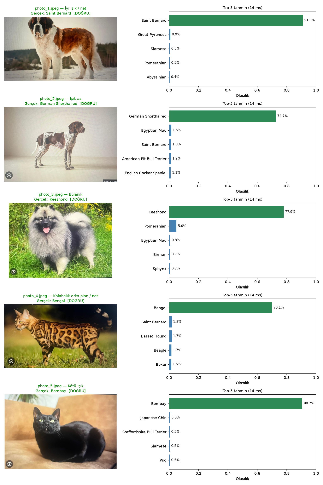

# Evcil Hayvan Irkı Sınıflandırma (Oxford-IIIT Pet + ResNet-50)

Bilgisayarlı Görü dersi ödevi. Bir kedi veya köpek fotoğrafından **37 ırktan** hangisi olduğunu tahmin eden,
transfer learning ile eğitilmiş bir derin öğrenme modeli ve bu modeli kullanan bir Gradio web uygulaması.

| | |
|---|---|
| **Görev** | Görüntü sınıflandırma (37 sınıf) |
| **Model** | ResNet-50 (ImageNet ön-eğitimli, transfer learning). Karşılaştırma için sıfırdan eğitilen basit CNN |
| **Veri seti** | [Oxford-IIIT Pet](https://www.robots.ox.ac.uk/~vgg/data/pets/): 7.349 görüntü, 12 kedi ve 25 köpek ırkı |
| **Uygulama** | Gradio |

## Proje Yapısı

```
├── app.py                  # Gradio uygulaması
├── requirements.txt
├── src/
│   ├── dataset.py          # Veri yükleme, train/val/test ayrımı
│   ├── model.py            # ResNet ve SimpleCNN tanımları
│   ├── train.py            # Eğitim (iki aşamalı transfer learning)
│   ├── evaluate.py         # Test metrikleri, confusion matrix, tahmin süresi
│   ├── predict_phone.py    # Telefon fotoğraflarıyla test
│   └── utils.py            # Ortak fonksiyonlar (cihaz, dönüşümler, tahmin)
├── phone_photos/           # Telefonla çekilen 5 fotoğraf ve labels.csv
├── models/                 # Eğitilmiş model (git'e eklenmez, bkz. Releases)
├── results/                # Grafikler ve metrik dosyaları
└── report/                 # Rapor (PDF)
```

## Kurulum

```bash
python3.11 -m venv .venv
source .venv/bin/activate
pip install -r requirements.txt
```

Veri seti ilk çalıştırmada `data/` klasörüne otomatik olarak iner (~800 MB).

## Kullanım

```bash
# 1) Eğitim
python -m src.train                                  # ResNet-50
python -m src.train --arch simple_cnn --ft-epochs 30 --ft-lr 1e-3 --out models/simple_cnn.pth   # baseline

# 2) Test kümesinde değerlendirme
python -m src.evaluate
python -m src.evaluate --ckpt models/simple_cnn.pth

# 3) Telefon fotoğraflarıyla test (önce phone_photos/labels.csv dosyasını doldur)
python -m src.predict_phone --list-classes            # geçerli sınıf adları
python -m src.predict_phone

# 4) Uygulama
python app.py                                         # http://127.0.0.1:7860
```

Eğitilmiş model dosyası GitHub'ın 100 MB sınırını aştığı için repoya eklenmedi. Dosya **[Releases](../../releases)**
sayfasında; indirip `models/best_model.pth` olarak kaydedin.

## Veri Ayrımı

| Küme | Kaynak | Görüntü |
|---|---|---|
| Eğitim | Resmi `trainval` kümesinin %85'i (stratified) | 3.128 |
| Doğrulama | Resmi `trainval` kümesinin %15'i (stratified) | 552 |
| Test | Resmi `test` kümesi | 3.669 |

Ön işleme: 224×224 boyut, ImageNet normalizasyonu. Eğitimde augmentation uygulandı: RandomResizedCrop, yatay çevirme,
±10° döndürme ve ColorJitter.

## Model ve Eğitim Ayarları

| Ayar | Değer | Gerekçe |
|---|---|---|
| Mimari | ResNet-50, son katman 37 çıkışlı `Linear` | Ön-eğitimli derin özellikler az veriyle yüksek başarı sağlar |
| Eğitim stratejisi | 3 epoch yalnız son katman, ardından 12 epoch tüm ağ | Önce rastgele başlatılan katmanı oturtup sonra ön-eğitimli ağırlıkları bozmadan ince ayar yapmak |
| Optimizer | AdamW | Adaptif öğrenme oranı ve ayrık weight decay sayesinde fine-tuning'de kararlı |
| Learning rate | 1e-3 (son katman), 1e-4 (fine-tune) | Ön-eğitimli ağırlıklar küçük adımlarla güncellenmeli |
| LR scheduler | CosineAnnealingLR | Öğrenme oranını yumuşakça düşürür |
| Batch size | 32 | Bellek ile genelleme arasında denge |
| Weight decay | 1e-4 | Overfitting'i azaltır |
| Aktivasyon / çıkış | ReLU (gizli katmanlar), Softmax (çıkış) | Çok sınıflı olasılık dağılımı |
| Loss | CrossEntropyLoss (label smoothing 0.1) | Çok sınıflı sınıflandırma. Smoothing aşırı güveni azaltır |
| Early stopping | 4 epoch boyunca val acc iyileşmezse durur | En iyi doğrulama modeli kaydedilir |

## Sonuçlar

> Eğitim tamamlandıktan sonra `results/` dosyalarındaki değerlerle doldurulacak.

| Model | Accuracy | Precision (macro) | Recall (macro) | F1 (macro) | Top-5 Acc | Eğitim süresi | Tahmin süresi (1 görüntü) |
|---|---|---|---|---|---|---|---|
| ResNet-50 | | | | | | | |
| SimpleCNN | | | | | | | |

Donanım: Apple M1, 16 GB (PyTorch MPS)

- Eğitim eğrileri: `results/best_model_training_curves.png`
- Confusion matrix: `results/best_model_confusion_matrix.png`
- Yanlış sınıflandırılan örnekler: `results/best_model_misclassified.png`

## Telefon Fotoğraflarıyla Test



> `results/phone_results.md` içeriği buraya yapıştırılacak ve yorumlanacak.

## Uygulama

> Gradio arayüzünün ekran görüntüsü buraya eklenecek.
