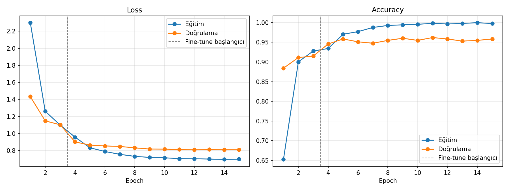

# Evcil Hayvan Irkı Sınıflandırma (Oxford-IIIT Pet + ResNet-50)

Bilgisayarlı Görü dersi ödevi. Bir kedi veya köpek fotoğrafından **37 ırktan** hangisi olduğunu tahmin eden,
transfer learning ile eğitilmiş bir derin öğrenme modeli ve bu modeli kullanan bir Gradio web uygulaması.

| | |
|---|---|
| **Görev** | Görüntü sınıflandırma (37 sınıf) |
| **Model** | ResNet-50 (ImageNet ön-eğitimli, transfer learning) |
| **Veri seti** | [Oxford-IIIT Pet](https://www.robots.ox.ac.uk/~vgg/data/pets/): 7.349 görüntü, 12 kedi ve 25 köpek ırkı |
| **Uygulama** | Gradio |

## Proje Yapısı

```
├── app.py                  # Gradio uygulaması
├── requirements.txt
├── src/
│   ├── dataset.py          # Veri yükleme, train/val/test ayrımı
│   ├── model.py            # ResNet ve SimpleCNN tanımları
│   ├── train.py            # Eğitim (iki aşamalı transfer learning)
│   ├── evaluate.py         # Test metrikleri, confusion matrix, tahmin süresi
│   ├── predict_phone.py    # Telefon fotoğraflarıyla test
│   └── utils.py            # Ortak fonksiyonlar (cihaz, dönüşümler, tahmin)
├── phone_photos/           # Telefonla çekilen 5 fotoğraf ve labels.csv
├── models/                 # Eğitilmiş model (git'e eklenmez, bkz. Releases)
├── results/                # Grafikler ve metrik dosyaları
└── report/                 # Rapor (PDF)
```

## Kurulum

```bash
python3.11 -m venv .venv
source .venv/bin/activate
pip install -r requirements.txt
```

Veri seti ilk çalıştırmada `data/` klasörüne otomatik olarak iner (~800 MB).

## Kullanım

```bash
# 1) Eğitim
python -m src.train                                  # ResNet-50
python -m src.train --arch simple_cnn --ft-epochs 30 --ft-lr 1e-3 --out models/simple_cnn.pth   # baseline

# 2) Test kümesinde değerlendirme
python -m src.evaluate
python -m src.evaluate --ckpt models/simple_cnn.pth

# 3) Telefon fotoğraflarıyla test (önce phone_photos/labels.csv dosyasını doldur)
python -m src.predict_phone --list-classes            # geçerli sınıf adları
python -m src.predict_phone

# 4) Uygulama
python app.py                                         # http://127.0.0.1:7860
```

Eğitilmiş model dosyası GitHub'ın 100 MB sınırını aştığı için repoya eklenmedi. Dosya **[Releases](../../releases)**
sayfasında; indirip `models/best_model.pth` olarak kaydedin.

## Veri Ayrımı

| Küme | Kaynak | Görüntü |
|---|---|---|
| Eğitim | Resmi `trainval` kümesinin %85'i (stratified) | 3.128 |
| Doğrulama | Resmi `trainval` kümesinin %15'i (stratified) | 552 |
| Test | Resmi `test` kümesi | 3.669 |

Ön işleme: 224×224 boyut, ImageNet normalizasyonu. Eğitimde augmentation uygulandı: RandomResizedCrop, yatay çevirme,
±10° döndürme ve ColorJitter.

## Model ve Eğitim Ayarları

| Ayar | Değer | Gerekçe |
|---|---|---|
| Mimari | ResNet-50, son katman 37 çıkışlı `Linear` | Ön-eğitimli derin özellikler az veriyle yüksek başarı sağlar |
| Eğitim stratejisi | 3 epoch yalnız son katman, ardından 12 epoch tüm ağ | Önce rastgele başlatılan katmanı oturtup sonra ön-eğitimli ağırlıkları bozmadan ince ayar yapmak |
| Optimizer | AdamW | Adaptif öğrenme oranı ve ayrık weight decay sayesinde fine-tuning'de kararlı |
| Learning rate | 1e-3 (son katman), 1e-4 (fine-tune) | Ön-eğitimli ağırlıklar küçük adımlarla güncellenmeli |
| LR scheduler | CosineAnnealingLR | Öğrenme oranını yumuşakça düşürür |
| Batch size | 32 | Bellek ile genelleme arasında denge |
| Weight decay | 1e-4 | Overfitting'i azaltır |
| Aktivasyon / çıkış | ReLU (gizli katmanlar), Softmax (çıkış) | Çok sınıflı olasılık dağılımı |
| Loss | CrossEntropyLoss (label smoothing 0.1) | Çok sınıflı sınıflandırma. Smoothing aşırı güveni azaltır |
| Early stopping | 4 epoch boyunca val acc iyileşmezse durur | En iyi doğrulama modeli kaydedilir |

## Eğitim Ortamı

- **Eğitim:** Google Colab, NVIDIA Tesla T4 GPU (15 GB), PyTorch 2.14 + CUDA
- **Uygulama ve telefon testleri:** Apple M1, 16 GB RAM, PyTorch MPS

## Sonuçlar

### Test kümesi (3.669 görüntü)

| Metrik | Değer |
|---|---|
| Accuracy | **%92.45** |
| Precision (macro) | 0.9265 |
| Recall (macro) | 0.9241 |
| F1-score (macro) | 0.9235 |
| Top-5 Accuracy | %98.96 |
| En iyi doğrulama doğruluğu | %96.20 (11. epoch) |

### Süreler

| | Değer |
|---|---|
| Toplam eğitim süresi (T4 GPU) | 9.8 dk (15 epoch, ~40 sn/epoch) |
| Tek görüntü tahmini, NVIDIA T4 GPU | 7.8 ms |
| Tek görüntü tahmini, Apple M1 GPU (MPS) | 14.9 ms |
| Tek görüntü tahmini, Apple M1 CPU | 34.5 ms |
| Toplu tahmin (batch 64), T4 GPU | 360 görüntü/sn |

### Eğitim eğrileri



Kesikli çizgi, gövdenin çözülüp tüm ağın eğitilmeye başlandığı (fine-tune) noktayı gösterir. İlk epoch'ta yalnızca
son katman eğitilmesine rağmen doğrulama doğruluğu %88'e ulaştı; bu, ImageNet ön-eğitiminin katkısını gösterir.
Label smoothing (0.1) kullanıldığı için kayıp değerleri sıfıra yaklaşmaz.

### Hata analizi

En çok karıştırılan sınıflar görsel olarak birbirine çok benzeyen ırklardır:

| Gerçek | Tahmin | Hata sayısı |
|---|---|---|
| American Pit Bull Terrier | Staffordshire Bull Terrier | 31 |
| Ragdoll | Birman | 17 |
| Egyptian Mau | Bengal | 13 |
| Staffordshire Bull Terrier | American Bulldog | 12 |
| American Pit Bull Terrier | American Bulldog | 12 |

- En düşük F1: American Pit Bull Terrier (0.62), Staffordshire Bull Terrier (0.68), Ragdoll (0.76)
- En yüksek F1 (~0.99): Pug, Sphynx, Japanese Chin, Shiba Inu, Leonberger, Newfoundland

Ayrıntılar: [sınıf bazlı rapor](results/best_model_classification_report.txt),
[confusion matrix](results/best_model_confusion_matrix.png),
[yanlış sınıflandırılan örnekler](results/best_model_misclassified.png)

## Telefon Fotoğraflarıyla Test

Fotoğraflar telefon kamerasıyla, bilgisayar ekranında açılan görsellerden çekilmiştir. Komut:
`python -m src.predict_phone`


| # | Fotoğraf | Gerçek | Tahmin (Top-1) | Güven | Top-5'te mi? | Sonuç |
|---|---|---|---|---|---|---|
| 1 | photo_1.jpeg | Saint Bernard | Saint Bernard | %91.0 | Evet | ✅ |
| 2 | photo_2.jpeg | German Shorthaired | German Shorthaired | %72.7 | Evet | ✅ |
| 3 | photo_3.jpeg | Keeshond | Keeshond | %77.9 | Evet | ✅ |
| 4 | photo_4.jpeg | Bengal | Bengal | %70.1 | Evet | ✅ |
| 5 | photo_5.jpeg | Bombay | Bombay | %90.7 | Evet | ✅ |

**Top-1 doğruluk: %100 (5/5)**. Her fotoğraf için tahmin süresi Apple M1 GPU'da yaklaşık 15 ms.

### Yorum

**Başarılı olduğu durumlar**
- Beş fotoğrafın tamamında model doğru ırkı birinci sırada ve yüksek farkla tahmin etti. İkinci tahminlerin olasılığı
  en fazla %5.
- Hayvanın tamamının görünmesi, tek hayvan olması ve kadrajın ortasında durması sınıflandırmayı kolaylaştırdı.
- Belirgin görünüşlü ırklarda güven en yüksek çıktı: Saint Bernard (%91.0) ve tamamen siyah kürklü Bombay (%90.7).
- Bengal kedisi, test kümesinde en çok Egyptian Mau ile karıştırılan sınıflardan biri olmasına rağmen doğru bilindi.
  Bu fotoğraftaki belirgin rozet desenli kürk ayırt edici oldu.

**Güvenin düştüğü durumlar**
- **German Shorthaired (%72.7):** Görselde ekran çekiminden kaynaklanan izler var: ekran dokusu, köşede görsel arama
  simgesi ve boyut etiketi. Hayvanın kadrajı kaplama oranı da küçük.
- **Keeshond (%77.9):** İkinci tahmin %5 ile Pomeranian. İki ırk da kabarık tüylü, spitz tipi köpekler olduğu için bu
  karışıklık anlamlı.
- **Bengal (%70.1):** Arka plan karanlık ve yeşil tonlu; hayvan profilden ve hareket halinde.

**Sınırlamalar**
- Bu örnekte başarısız tahmin olmadı, ancak 5 fotoğraf genelleme için küçük bir örneklem. Fotoğraflar ekrandaki
  profesyonel ırk görsellerinden çekildiği için eğitim verisine (internetten toplanmış fotoğraflar) benziyor; bu da
  sonucu iyimser yapıyor. Gerçek ortamda, kısmen görünen, birden fazla olan veya hareketli hayvanlarda başarının
  düşmesi beklenir.
- Test kümesinde en zor sınıflar birbirine çok benzeyen ırklardı (American Pit Bull Terrier ↔ Staffordshire Bull
  Terrier, Ragdoll ↔ Birman). Bu ırklardan bir fotoğraf olsaydı hata olasılığı daha yüksek olurdu.
- Model yalnızca 37 ırktan birini seçebilir (kapalı küme sınıflandırma). Veri setinde olmayan bir ırk ya da melez bir
  hayvan verildiğinde de bu 37 sınıftan birini söyler. Uygulama bu yüzden güven %40'ın altına düştüğünde kullanıcıyı
  uyarıyor.

## Uygulama

> Gradio arayüzünün ekran görüntüsü buraya eklenecek.
